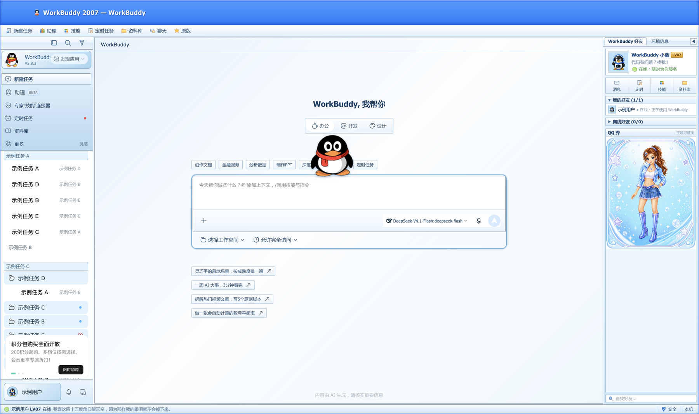
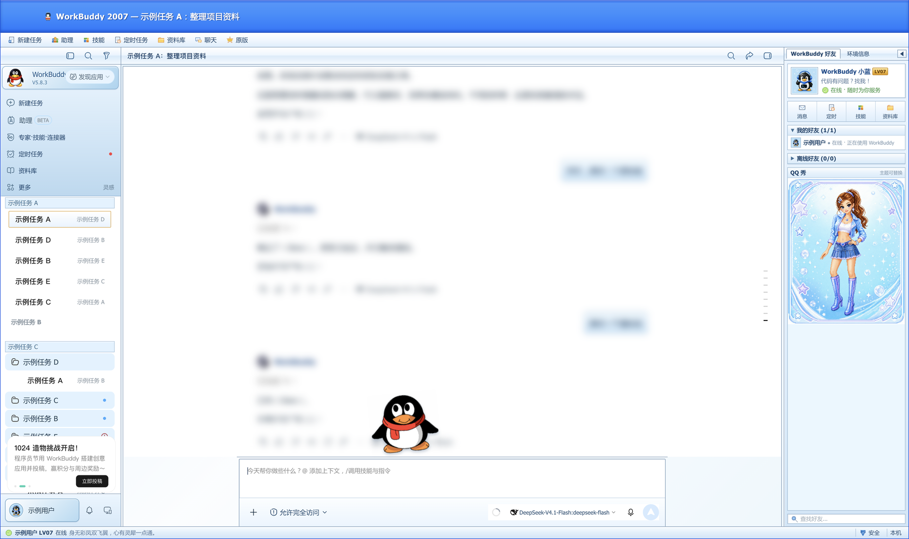
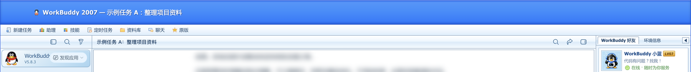
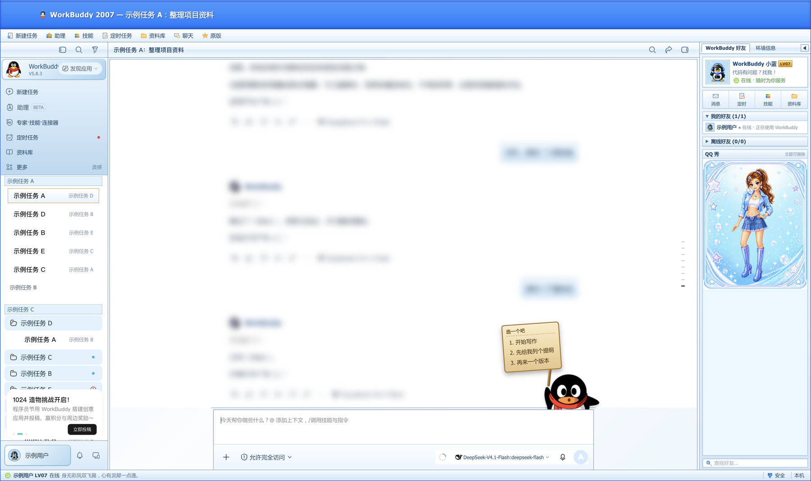
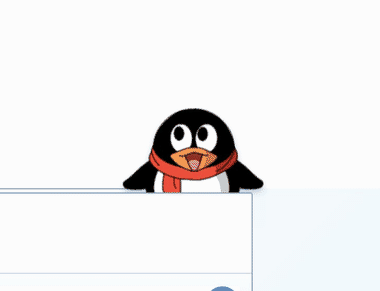
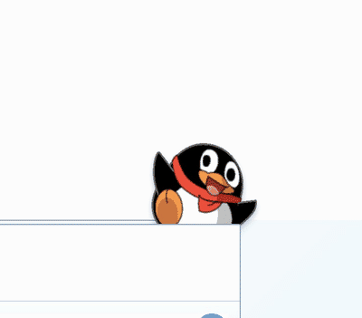
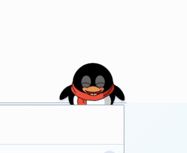
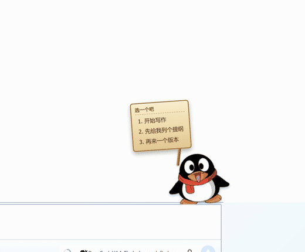
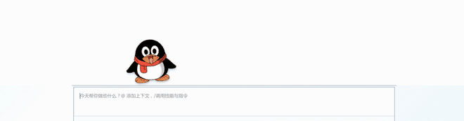

<div align="center">

# WorkBuddy QQ 2007 Theme

**把 WorkBuddy 变回 2007 年的 QQ 客户端 —— XP Luna 蓝标题栏、好友面板、QQ 秀、经典签名，还有一只真的会动、会举牌、会撒娇的 QQ 宠物。**

[]()
[]()
[]()
[](https://github.com/Fengoffer/workbuddy-qq2007-theme/actions/workflows/ci.yml)

[效果预览](#效果预览) · [功能](#功能) · [QQ-宠物](#qq-宠物) · [安装](#安装) · [AI-一键安装](#ai-一键安装) · [安全与回滚](#安全与回滚) · [常见问题](docs/TROUBLESHOOTING.md) · [兼容性](docs/COMPATIBILITY.md) · [维护文档](docs/MAINTAINING.md)

</div>

---

> **仓库地址：** GitHub · https://github.com/Fengoffer/workbuddy-qq2007-theme ｜ Gitee 镜像 · https://gitee.com/fengoffer/workbuddy-qq2007-theme
>
> 这是一个 **WorkBuddy 5.8.3** 的第三方 QQ 2007 怀旧皮肤。它只改动 WorkBuddy.app 里的主题资源，不修改 `app.asar`、不读写你的会话、账号、文件或任何用户数据。安装前会自动备份，随时可以一键恢复原版。
>
> **非腾讯 / 非 WorkBuddy 官方项目，与两家公司均无关联。** 仅供个人学习、怀旧和本地美化使用。

## 效果预览

> 截图来自真实运行中的 WorkBuddy，已对历史会话标题、对话内容、用户名和头像做脱敏处理。

| 首页 | 会话界面 |
| --- | --- |
|  |  |

| 标题栏 + 菜单栏 | 状态栏经典签名 |
| --- | --- |
|  |  |

| 宠物举牌选项 |
| --- |
|  |

## 功能

### 1. 完整的 QQ 2007 客户端外壳

- **Windows XP Luna 蓝色标题栏**：渐变高光、内描边、左上角企鹅图标，macOS 原生红绿灯垂直居中（按 64px 标题栏对齐，不遮挡、不偏移）；
- **QQ 2007 菜单栏**：新建任务 / 助理 / 技能 / 定时任务 / 资料库 / 聊天 / 原版，全部映射到 WorkBuddy 原有功能；
- **右侧好友面板**：WorkBuddy 好友卡片、在线状态、消息 / 定时 / 技能 / 资料库快捷入口、QQ 秀展示位、可折叠；
- **底部状态栏**：用户等级、在线状态、经典 QQ 签名轮播、安全 / 本机状态；
- **可拖动分栏**：左侧会话列表宽度可拖拽，带指针捕获，拖动时不卡顿；折叠侧栏后布局自动让位；
- **窗口边框**：1px 亮蓝描边 + 内高光，还原 XP 窗口质感。

### 2. QQ 2007 聊天界面重绘

- 会话页变成 XP 风格的白色凹陷面板，浅蓝渐变工具条；
- 左右聊天气泡、输入框、发送键、模型选择器、权限提示全部重新配色；
- 标题栏、会话列表、消息文字使用 PingFang SC 中等字重，避免粗体发虚；
- 保留 WorkBuddy 原生交互：流式输出、停止、复制、重新生成、附件、产物卡片全部可用。

### 3. 经典 QQ 签名

- 内置 **373 条**从互联网整理的经典 QQ 签名 / 非主流语录 / 古风诗词；
- 状态栏每 20~60 秒随机淡入淡出切换，点击可立即换一条；
- 避免连续重复；不影响昵称、等级、在线状态。

### 4. 通知音替换

- 拦截 WorkBuddy 内置通知音 `sounds/*.wav`（calm/bright/playful），统一替换为 **经典 QQ 滴滴声**；
- 兼容 `audio.play()`、`audio.src =`、`setAttribute('src')`、`new Audio()`、`fetch` 等多种播放路径；
- 900ms 去重，避免连续通知叠音；原生通知静音，避免「咚 + 滴滴」双响。

### 5. 安全安装 / 回滚

- 安装前自动备份 `app.asar` 与 `index.html` 到时间戳目录；
- 只写 `app.asar.unpacked/renderer/` 下的主题文件与 `index.html`，**从不写 app.asar**；
- 强制保持 `index.html` 的字节数与 asar 头部记录完全一致，避免 Electron 截断导致白屏 / React #299；
- 任何一步校验失败自动回滚 `index.html`；
- 提供卸载脚本，一键恢复原版。

### 6. 原版功能的让位

- 设置窗口、文件查看、浏览器等**次级窗口恢复完全原生**，不再被 QQ 外壳遮挡；
- 主窗口打开 WorkBuddy 自带的右侧面板（detail-panel / sources-panel）时，主题好友栏自动收起并让出宽度，关闭面板后自动恢复。

## QQ 宠物

这是这套主题最花时间的部分：**不是贴图动画，而是真正的 QQ 宠物 Flash 动画**。

- 使用 [Ruffle](https://ruffle.rs/)（WebAssembly Flash 模拟器，MIT / Apache-2.0）在 WorkBuddy 渲染进程里播放 `.swf`；
- 宠物动作素材来自开源项目 **[xuemian168/qqpet_automation](https://github.com/xuemian168/qqpet_automation)**（QQ 宠物怀旧服逆向 / 移植项目），按其仓库提供的动作文件读取、播放；
- 我们只做 **本地播放与行为编排**，不修改原项目代码；素材版权归腾讯 / 原项目作者所有，**请勿用于商业用途**，详见 [THIRD_PARTY_NOTICES.md](THIRD_PARTY_NOTICES.md)。

### 行为

| 场景 | 行为 |
| --- | --- |
| 待机 | 趴在输入框边缘，下半身藏在输入框后面；随机眨眼、呼吸、挥翅膀 |
| 点击 | 弹跳 + 头顶冒爱心 + 随机互动动作（H1 / H2 / H3 / LF1 / BE1 / BE2 / BE3） |
| 输入时 | 踮脚抬头看输入框 |
| 打开会话 | 沿输入框边缘从左边跑到右边 |
| 出现选项 | 举木牌列出 1/2/3，点牌子条目直接触发对应选项 |
| 空闲随机 | 每 8~16 秒随机播一个玩耍动作（P1 泡澡 / P2 / P5 / P13 / P17 / P22 / P27） |
| 说话 | 随机播放 Speak / Speak-peaceful 口型动画 |

### 动作 GIF

| 待机 | 玩耍 |
| --- | --- |
|  |  |

| 点击互动 | 举牌选项 |
| --- | --- |
|  |  |

| 跑过输入框 |
| --- |
|  |

> 动作池共 19 个 SWF：待机 3、玩耍 7、点击互动 7、说话 2；跑动使用 CSS 位移（`Enter1.swf` 是带草地背景的入场动画，不适合叠加在输入框上，因此未使用）。
>
> **全部 19 个动作的 GIF 动图见 [docs/PET_ACTIONS.md](docs/PET_ACTIONS.md)。**

### 性能与加载

- 启动时用离屏播放器预热 Ruffle 内核（约 0.5s 完成），与 WorkBuddy 自身启动重叠，输入框出现时宠物基本立刻可用；
- 首次安装后第一次运行需要编译约 12MB wasm（一次性，之后走缓存）；
- 窗口隐藏 / 失焦时暂停 Ruffle 渲染；
- 选项检测只监听消息列表，350ms 防抖，避免流式输出卡顿。

## 安装

### 环境要求

- **WorkBuddy 5.8.3**（macOS 已验证；Windows 见下方说明）
- 主题只适用于 **renderer/index.html 被标记为 unpacked** 的 WorkBuddy 安装结构；
- macOS 需要 Python 3（系统自带 `/usr/bin/python3` 即可）；
- 安装前请先 **完全退出 WorkBuddy**（安装器也会尝试自动退出）。

### macOS（推荐）

```bash
# GitHub
git clone --depth 1 https://github.com/Fengoffer/workbuddy-qq2007-theme.git
# 国内网络可改用 Gitee 镜像
# git clone --depth 1 https://gitee.com/fengoffer/workbuddy-qq2007-theme.git
cd workbuddy-qq2007-theme
bash scripts/macos/install.sh
```

可选参数：

```bash
bash scripts/macos/install.sh --app /Applications/WorkBuddy.app   # 指定 App 路径
bash scripts/macos/install.sh --no-launch                        # 安装后不自动打开
bash scripts/macos/install.sh --force                            # 跳过 5.8.3 版本提示（不推荐）
```

安装器会：

1. 检查 WorkBuddy 版本与目录结构；
2. 退出 WorkBuddy；
3. 把 `app.asar` 和 `index.html` 备份到 `~/WorkBuddy/QQ2007ThemeBackups/<时间戳>/`；
4. 复制主题资源到 `app.asar.unpacked/renderer/assets/`；
5. 在 `index.html` 注入主题引用，并严格保持 asar 记录的字节数；
6. 校验失败自动回滚。

### Windows（实验性）

Windows 安装器 `scripts/windows/install.ps1` 已提供，但 **作者环境为 macOS，尚未在 Windows 实机验证**。它会：

- 自动查找 WorkBuddy 安装目录（常见 `%LOCALAPPDATA%\Programs\WorkBuddy`、`Program Files`、注册表卸载项）；
- 仅当存在 `resources\app.asar.unpacked\renderer\index.html` 时才安装；
- 如果 WorkBuddy 把 renderer 打包在 `app.asar` 里（没有 unpacked 目录），安装器会 **安全退出，不做任何修改**，避免破坏完整性校验；
- 备份到 `%USERPROFILE%\WorkBuddy\QQ2007ThemeBackups\<时间戳>\`；
- 同样强制保持 `index.html` 字节数。

```powershell
git clone --depth 1 https://github.com/Fengoffer/workbuddy-qq2007-theme.git
cd workbuddy-qq2007-theme
powershell -ExecutionPolicy Bypass -File scripts\windows\install.ps1
```

如果提示找不到目录，可指定：

```powershell
powershell -ExecutionPolicy Bypass -File scripts\windows\install.ps1 -AppPath "C:\Users\你\AppData\Local\Programs\WorkBuddy" -Kill
```

> 如果你的 Windows WorkBuddy 是 packed `app.asar` 结构，请不要强行修改 `app.asar`：Electron 的完整性校验可能导致应用无法启动。可以提 Issue 附上目录结构，我们再做适配。

### 卸载 / 恢复原版

```bash
# macOS
bash scripts/macos/uninstall.sh

# Windows
powershell -ExecutionPolicy Bypass -File scripts\windows\uninstall.ps1
```

卸载会移除主题注入与主题资源，并按 asar 记录的字节数重新对齐 `index.html`。如果应用已经无法启动，先运行卸载脚本再打开 WorkBuddy；如仍异常，见 [安全与回滚](#安全与回滚)。

## AI 一键安装

把下面这段直接发给你的 AI 编程助手（Claude Code / Codex / Cursor / ChatGPT Agent 均可）：

```text
你是我的 macOS/Windows 桌面助手。请帮我安装 WorkBuddy QQ 2007 主题：
仓库：https://github.com/Fengoffer/workbuddy-qq2007-theme
（国内网络可用 Gitee 镜像：https://gitee.com/fengoffer/workbuddy-qq2007-theme）
要求：
1. 先完全退出 WorkBuddy，确认没有 WorkBuddy 进程在运行；
2. 用 git clone --depth 1 把仓库克隆到临时目录；
3. 读取仓库 README 与 docs/SAFETY.md、docs/TROUBLESHOOTING.md；
4. macOS 运行 bash scripts/macos/install.sh；Windows 运行 scripts/windows/install.ps1；
5. 安装器会自动备份到 ~/WorkBuddy/QQ2007ThemeBackups/ 或 %USERPROFILE%\WorkBuddy\QQ2007ThemeBackups\；
6. 安装完成后打开 WorkBuddy 验证：能正常显示 QQ 2007 标题栏、好友面板、聊天界面和宠物；
7. 如果启动失败/白屏，立即运行对应的 uninstall 脚本恢复原版，并把安装器输出和错误日志发给我；
8. 禁止直接修改 app.asar，禁止读写我的 WorkBuddy 会话、账号、文件数据；
9. 不要删除任何备份目录。
```

更完整的 AI 安装约定见 [AI_INSTALL.md](AI_INSTALL.md)。

## 安全与回滚

### 数据安全承诺

- 主题 **不会** 修改 WorkBuddy 的 `app.asar`；
- 主题 **不会** 读写 `~/Library/Application Support/WorkBuddy`、`%APPDATA%\WorkBuddy` 中的会话、账号、缓存、数据库；
- 主题 **不会** 上传任何数据、不包含遥测；
- 所有改动都发生在 `WorkBuddy.app/Contents/Resources/app.asar.unpacked/renderer/` 或 Windows 对应 `resources\app.asar.unpacked\renderer\` 下；
- 安装前强制备份，任何校验失败自动回滚。

### 备份位置

| 平台 | 目录 |
| --- | --- |
| macOS | `~/WorkBuddy/QQ2007ThemeBackups/<时间戳>/` |
| Windows | `%USERPROFILE%\WorkBuddy\QQ2007ThemeBackups\<时间戳>\` |

每个备份目录包含 `app.asar`、`index.html`、`metadata.json`、`SHA256.txt`。

### 回滚方式

1. **普通回滚**：运行卸载脚本（见上）；
2. **应用无法启动**：确认 WorkBuddy 已退出 → 运行卸载脚本 → 再打开；
3. **极端情况（asar 被误改）**：macOS 执行
   `bash scripts/macos/uninstall.sh --restore-asar ~/WorkBuddy/QQ2007ThemeBackups/<时间戳>`
   （Windows 用 `-RestoreAsar`），从备份恢复整个 `app.asar`；
4. 如仍有问题，删除 `~/WorkBuddy/QQ2007ThemeBackups/<时间戳>` 之外不要删除任何用户数据；可以提 Issue 附上 `metadata.json` 和安装输出。

## 常见问题

完整排查见 [docs/TROUBLESHOOTING.md](docs/TROUBLESHOOTING.md)。这里列出最常见的几个：

<details>
<summary><b>安装后 WorkBuddy 白屏 / 无法启动</b></summary>

几乎都是 `index.html` 字节数与 asar 头部记录不一致导致 Electron 截断。处理：

```bash
bash scripts/macos/uninstall.sh
env -u ELECTRON_RUN_AS_NODE open -a /Applications/WorkBuddy.app
```

如果仍启动失败，用备份恢复 `app.asar`（见「安全与回滚」）。
</details>

<details>
<summary><b>提示「不是 unpacked renderer 结构」</b></summary>

说明你的 WorkBuddy 版本把 `renderer/index.html` 打包在 `app.asar` 内。安装器不会冒险修改 `app.asar`，因此安全退出。可以提 Issue 附上 `Resources` 目录结构。
</details>

<details>
<summary><b>菜单栏没有「原版」按钮 / 皮肤关不掉</b></summary>

点击右上角菜单栏的「原版」即可关闭皮肤；或者执行卸载脚本。皮肤开关状态存在 `localStorage.WORKBUDDY_QQ2008_SKIN_ENABLED`。
</details>

<details>
<summary><b>宠物不见了</b></summary>

先确认皮肤开启、网络正常；宠物是本地 Ruffle 渲染，首次加载需要编译 wasm，等待几秒即可。若仍不显示，打开开发者工具查看 `[QQ 2007 pet]` 日志。
</details>

<details>
<summary><b>通知音不是 QQ 滴滴</b></summary>

主题会拦截 WorkBuddy 内置 `sounds/*.wav`。如果 WorkBuddy 更新后改了通知音路径，需要更新主题的 hook；可以提 Issue。
</details>

<details>
<summary><b>左下角 / 好友列表显示的用户名不是我的账号</b></summary>

主题优先从 WorkBuddy 账号服务读取当前登录账号，账号异步加载完成后自动同步，侧栏收起 / 冷启动也能显示；账号服务不可用时回退用户菜单 DOM，未登录时显示「WorkBuddy 用户」。

如果一直显示错误名字：确认装的是最新版本（`git pull` 后重新运行安装脚本），并展开一次左侧栏让账号菜单渲染；仍然不对请提 Issue 附 WorkBuddy 版本和脱敏截图。
</details>

<details>
<summary><b>右侧好友列表里的专家 / 技能是怎么来的？</b></summary>

在线列表来自 WorkBuddy 的「最近使用」专家；离线列表是已安装技能和自定义 / 云同步专家。好友列表每 30 秒刷新一次，启动后前几秒会补刷新等待 App 服务就绪。

WorkBuddy 目前没有暴露精确的「今天使用」时间戳，所以在线列表暂按「最近使用」计算；如果后续需要严格按自然日划分，可以增加本地使用时间记录。
</details>

<details>
<summary><b>Windows 支持吗？</b></summary>

提供实验性脚本，但仅在 WorkBuddy 具有 unpacked renderer 结构时可用；作者没有 Windows 实机，欢迎测试反馈。
</details>

## 目录结构

```
workbuddy-qq2007-theme/
├── theme/                     # 注入到 WorkBuddy 的主题资源
│   ├── qq2008-skin.css        # QQ 2008 基础皮肤
│   ├── qq2008-583-adapter.css # WorkBuddy 5.8.3 聊天适配
│   ├── qq2007-chrome.css/js   # QQ 2007 外壳 / 宠物 / 签名 / 通知音
│   ├── qq2008-notify.js       # 皮肤开关、任务声音
│   ├── qq7pet/                # Ruffle + 宠物 SWF
│   └── *.png / *.wav
├── scripts/
│   ├── common/                # 跨平台 index 字节对齐工具
│   ├── macos/                 # install.sh / uninstall.sh
│   ├── windows/               # install.ps1 / uninstall.ps1
│   ├── maintenance/           # 只读安装校验 / 双远端同步
│   └── ci/                    # CI 仓库卫生检查
├── tests/                     # Python 单元测试（注入 / 对齐 / 幂等性）
├── docs/                      # 安装、安全、排错、兼容性、维护、截图、GIF
├── .github/                   # CI、Issue / PR 模板
├── AI_INSTALL.md
├── THIRD_PARTY_NOTICES.md
└── README.md
```

## 镜像仓库

- GitHub：https://github.com/Fengoffer/workbuddy-qq2007-theme
- Gitee：https://gitee.com/fengoffer/workbuddy-qq2007-theme

两个仓库内容同步更新；国内访问 Gitee 更快，AI 一键安装也可以把 clone 地址换成 Gitee。

## 维护与发布

- **兼容性矩阵**：[docs/COMPATIBILITY.md](docs/COMPATIBILITY.md) —— 已验证的 WorkBuddy 版本、安装后验收清单、WorkBuddy 升级后的适配流程；
- **维护手册**：[docs/MAINTAINING.md](docs/MAINTAINING.md) —— 分支与版本策略、发布检查清单、双仓库同步、常见维护任务、紧急回滚；
- **质量保障**：GitHub Actions 会运行 Python 单元测试、ShellCheck、PowerShell 语法、JavaScript 语法、仓库卫生与版本一致性检查；本机可用 `bash scripts/maintenance/verify-install.sh` 只读检查注入状态。

## 贡献

欢迎 Issue / PR，尤其是：

- Windows 实机安装反馈（目录结构、报错、截图）；
- 新版本 WorkBuddy 的 DOM 适配；
- 更多 QQ 宠物动作（需确认素材来源与许可证）；
- 文案、截图、GIF 优化。

提交前请确保不包含任何真实会话、账号、文件名或隐私数据；提交 PR 前请先跑一遍仓库自带的检查（见 [PR 模板](.github/PULL_REQUEST_TEMPLATE.md) 与 [维护手册](docs/MAINTAINING.md)）。

## 许可证

- **主题代码**（CSS / JS / 安装脚本 / 文档）：[MIT](LICENSE)
- **Ruffle**：MIT / Apache-2.0
- **QQ 宠物动作素材**：来自 [xuemian168/qqpet_automation](https://github.com/xuemian168/qqpet_automation)，版权归腾讯 / 原项目作者，仅限个人怀旧与学习使用，**不得商用**；
- 其他第三方声明见 [THIRD_PARTY_NOTICES.md](THIRD_PARTY_NOTICES.md)。

## 免责声明

本项目是非官方第三方主题，与腾讯、WorkBuddy 官方无任何关联。使用本主题造成的应用异常、数据风险由使用者自行承担；安装器已尽最大努力做备份、校验与回滚，但请仍然在安装前自行备份重要数据。
