# QQ 宠物动作一览

宠物动作全部由 **Ruffle** 播放 **xuemian168/qqpet_automation** 提供的 QQ 宠物 `.swf` 文件；以下是 19 个动作的真实运行 GIF（已裁剪到宠物区域，不含会话内容）。

动作选择是随机的：
- 待机：每 8~16 秒可能随机切换待机/玩耍；
- 玩耍：`P1 / P2 / P5 / P13 / P17 / P22 / P27` 中随机；
- 点击宠物：`H1 / H2 / H3 / LF1 / BE1 / BE2 / BE3` 中随机，并附带弹跳 + 爱心；
- 出现选项：`Speak / Speak-peaceful` 中随机，并举起木牌；
- 打开会话：CSS 跑动动画（未使用带背景的 `Enter1.swf`）。

## 待机（3）

| 动作 | 文件 | GIF |
| --- | --- | --- |
| 标准待机 | `Stand.swf` | 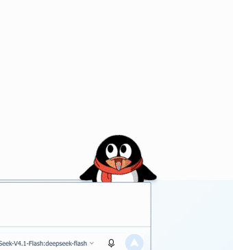 |
| 开心待机 | `Stand-happy.swf` | 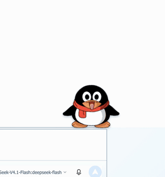 |
| 安静待机 | `Stand-peaceful.swf` | 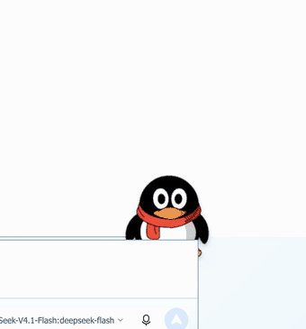 |

## 玩耍（7）

| 动作 | 文件 | GIF |
| --- | --- | --- |
| 泡澡 | `P1.swf` | 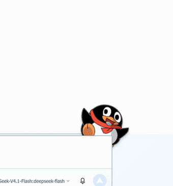 |
| 玩耍 2 | `P2.swf` | 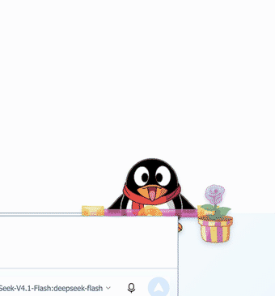 |
| 玩耍 5 | `P5.swf` | 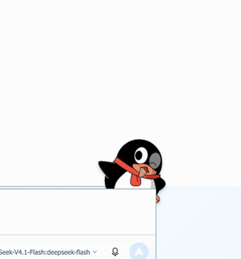 |
| 玩耍 13 | `P13.swf` | 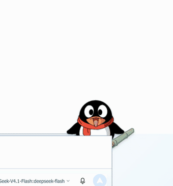 |
| 玩耍 17 | `P17.swf` | 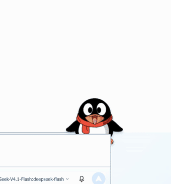 |
| 玩耍 22 | `P22.swf` | 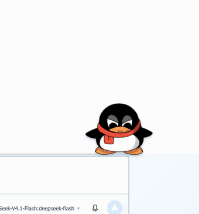 |
| 玩耍 27 | `P27.swf` | 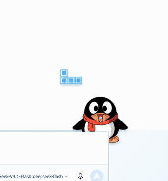 |

## 点击互动（7）

| 动作 | 文件 | GIF |
| --- | --- | --- |
| 摸头 1 | `H1.swf` | 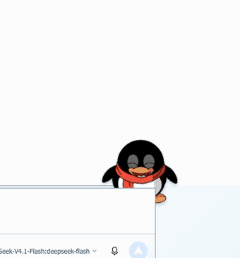 |
| 摸头 2 | `H2.swf` | 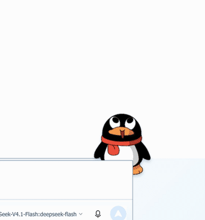 |
| 摸头 3 | `H3.swf` | 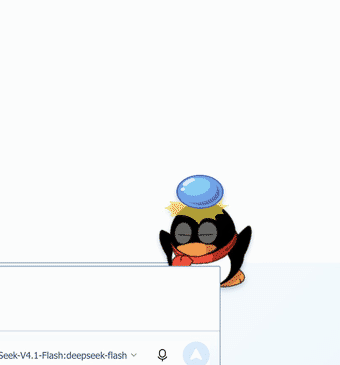 |
| 互动 LF1 | `LF1.swf` | 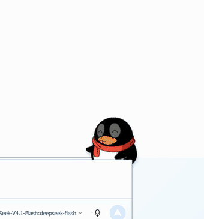 |
| 互动 BE1 | `BE1.swf` | 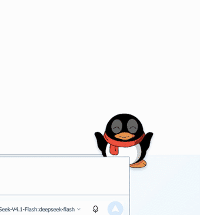 |
| 互动 BE2 | `BE2.swf` | 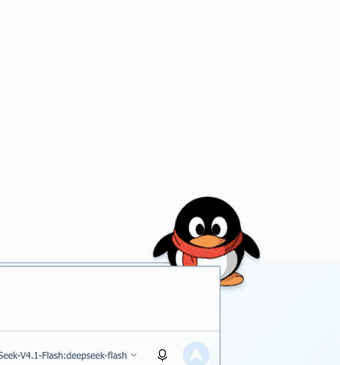 |
| 互动 BE3 | `BE3.swf` | 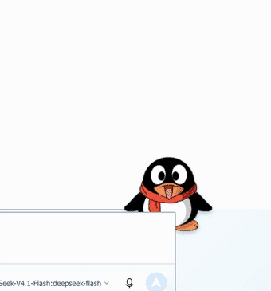 |

## 说话（2）

| 动作 | 文件 | GIF |
| --- | --- | --- |
| 说话 | `Speak.swf` | 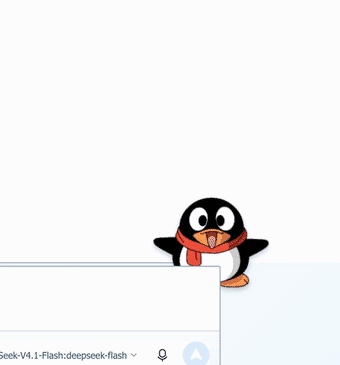 |
| 安静说话 | `Speak-peaceful.swf` | 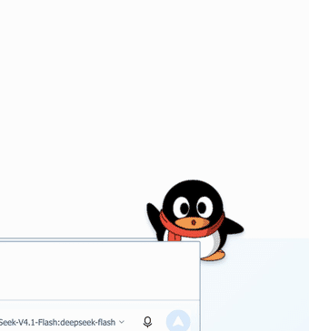 |

## 组合状态

| 状态 | GIF |
| --- | --- |
| 趴在输入框上待机 |  |
| 举牌列选项 |  |
| 打开会话跑过输入框 |  |

> 素材版权说明见 [THIRD_PARTY_NOTICES.md](../THIRD_PARTY_NOTICES.md)：QQ 宠物美术/动画归腾讯所有，`qqpet_automation` 为开源移植项目；仅限个人怀旧使用，禁止商用。
